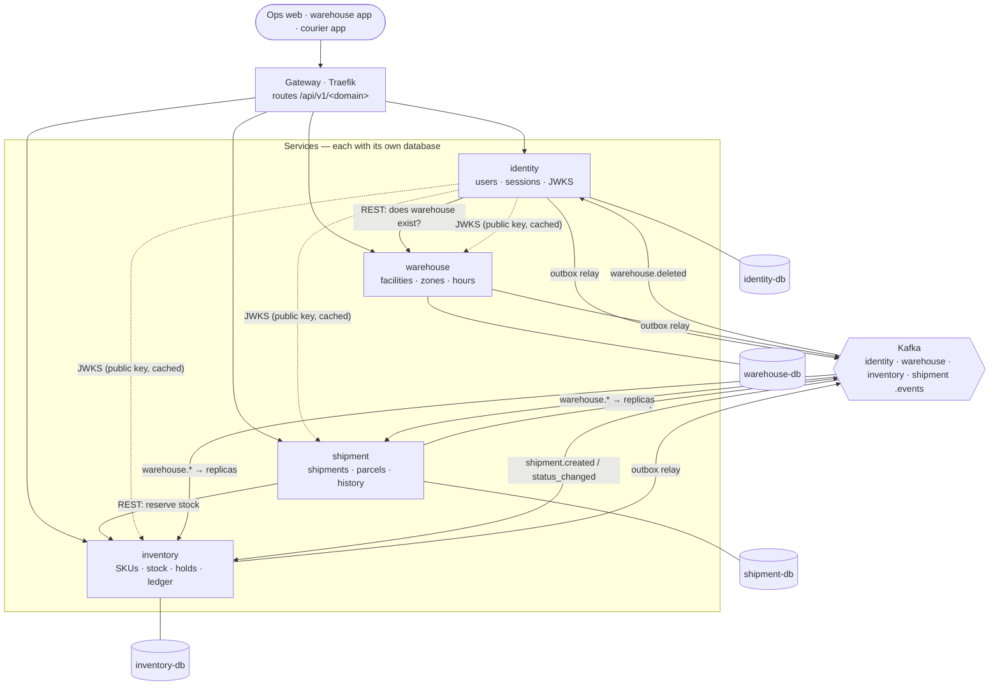

# SmartLogistics — Microservices

Backend for TransFleet's supply-chain and delivery orchestration platform, rebuilt
from the Phase 1 modular monolith into independently deployable services. The
monolith lives on in git history (the `phase_1` branch) for reference.

Each service owns an **isolated database instance**, verifies tokens on its own,
and talks to the others only through **REST** (immediate questions), **Kafka
events** (facts others react to) and, from Week 2, **Temporal** workflows.

## Architecture



| Service | Owns | Publishes | Consumes | Calls |
|---|---|---|---|---|
| **identity** | users, refresh tokens, operator↔warehouse scopes | `user.*` | `warehouse.deleted` (drop scopes) | warehouse (validate an assignment) |
| **warehouse** | warehouses, zones, operating hours | `warehouse.*` (full snapshots) | — | — |
| **inventory** | SKUs, stock positions, holds, stock ledger, warehouse replica | `stock.*` | `warehouse.*`, `shipment.created` (confirm hold), `shipment.status_changed` (commit / release) | — |
| **shipment** | shipments, items, parcels, status history, warehouse replica | `shipment.*` | `warehouse.*` | inventory (reserve, release) |

Courier, orchestrator (Temporal), tracking, notification and analytics services
arrive in Weeks 2–3; the AI assistant and indexer in Weeks 4–5. The full plan is in
the *Microservices Migration Plan* doc.

## How the hard parts work

**Authentication.** Identity signs RS256 access tokens whose claims carry role,
warehouse scope and courier id. Every other service fetches Identity's public key
from `/.well-known/jwks.json` once, caches it in memory, and verifies tokens
locally — no service calls Identity on the request path.

**Creating a shipment (reserve, then record).**
1. Shipment checks the origin warehouse against its *local replica* (built from
   `warehouse.*` events) — no call.
2. It calls Inventory to hold the stock (the one synchronous hop). Rows are locked
   in id order; a shortfall is Inventory's own `409 insufficient_stock`.
3. It inserts the shipment, items (SKU snapshots returned by Inventory), the first
   history row and a `shipment.created` outbox row — one transaction.
4. Inventory consumes `shipment.created` and **confirms** the hold. Confirmed holds
   never expire; only holds whose shipment never materialised are reclaimed.
5. If step 3 fails, Shipment releases the hold straight away (compensation). With an
   `Idempotency-Key`, the shipment id is derived from the key, so a retry reuses the
   same hold instead of reserving twice.

Later, `shipment.status_changed` → `dispatched` **commits** the hold (stock leaves
the shelf, a ledger row is written) and → `cancelled` **releases** it.

**Service-to-service calls.** All REST calls go through one client with timeouts,
retries (only for reads or keyed writes), a circuit breaker, and the caller's token
forwarded so the callee applies its own permission checks. A remote error such as
`409 insufficient_stock` reaches the client unchanged.

**Consistency.** Every event is written to an `outbox_events` table in the same
transaction as the change and relayed to Kafka. Consumers record the event id in
`processed_events` in the same transaction as their effect, so redelivery is a
no-op on any pod. Write endpoints accept `Idempotency-Key` (scoped per caller,
leased, atomic with the work). Shipment status changes are protected by a real
optimistic lock (`version_id_col`): two pods updating the same shipment → one
wins, the other gets `409 concurrent_update`. Stock rows are always locked items
first, in id order, then holds, so concurrent reservations cannot deadlock.

**No foreign keys across services.** References are plain ids. Display fields are
snapshotted (warehouse code, SKU name); cascades became events (deleting a
warehouse removes operator scopes in Identity via `warehouse.deleted`).

## Run it

One developer CLI does everything, on every OS.

**Prerequisites:** [uv](https://docs.astral.sh/uv/getting-started/installation/)
(it installs Python 3.12+ for you) and Docker Desktop, or Docker Engine with the
Compose plugin. Free ports: 5441–5444, 29092, 16686, and 8001–8004 (option A) or
8000/8080 (option B).

| macOS / Linux | Windows PowerShell | Windows cmd |
|---|---|---|
| `./dev.sh <command>` | `.\dev.ps1 <command>` | `dev <command>` |

The wrappers create the workspace virtualenv on first run, then call
`scripts/dev.py`, so every command behaves the same everywhere. `make <target>`
aliases are there too for macOS/Linux users who prefer them.

### Option A — services on your machine, infrastructure in Docker (best for coding)

```bash
./dev.sh setup        # install the workspace + generate Identity's signing key
./dev.sh infra up     # 4 Postgres (5441-5444), Kafka (29092), Jaeger, gateway (8000)
./dev.sh migrate      # every service; or: ./dev.sh migrate shipment inventory
./dev.sh seed         # warehouses, users, SKUs and stock, in the right order
./dev.sh start        # 4 APIs (8001-8004) + 4 workers in one terminal; Ctrl+C stops all
```

The same gateway as in Docker runs on :8000 and forwards to the services on your
machine, so `http://localhost:8000` and the Swagger UI at `/docs` work in both options.
On Linux the APIs listen on all interfaces so the gateway container can reach them;
set `SL_BIND_HOST=127.0.0.1` if you don't need the gateway.

`start --reload` restarts a service when its code changes, `start shipment inventory`
runs a subset, and `start --no-workers` skips the Kafka workers. `./dev.sh status`
shows every service's health; `./dev.sh reset` rolls back, migrates and re-seeds.

### Option B — everything in Docker

```bash
./dev.sh docker up    # builds 4 images; databases, Kafka, gateway on :8000, Jaeger
./dev.sh docker seed
./dev.sh docker logs shipment     # docker ps | migrate | down [-v]
```

### Try it

```bash
TOKEN=$(curl -s localhost:8000/api/v1/auth/login -H 'content-type: application/json' \
  -d '{"email":"support.lead@transfleet.com","password":"SmartLogistics!2026"}' | jq -r .access_token)
curl -s localhost:8000/api/v1/shipments -H "Authorization: Bearer $TOKEN" | jq
```

## API docs

**All APIs in one place: http://localhost:8000/docs.** It's one Swagger UI with a dropdown
per service. Authorize once and the token is kept as you switch services. "Try it
out" goes through the gateway, like a real client.

| URL / file | What |
|---|---|
| http://localhost:8000/docs | Swagger UI for every service, behind the gateway |
| http://localhost:8000 | Gateway: every API under `/api/v1/...` |
| http://localhost:800{1,2,3,4}/docs | One service's own Swagger UI, bypassing the gateway |
| `docs/curl/index.html` | Offline reference: every endpoint with a copy-ready curl command |
| `docs/curl/openapi.json` | All four specs merged into one, ready to import into Postman, Insomnia or Bruno |
| `docs/curl/*.postman_*.json` | Postman collection (a folder per service) and environment |
| http://localhost:8080 | Traefik dashboard |
| http://localhost:16686 | Jaeger traces |
| `docker compose --profile tools up -d kafka-ui` → :8090 | Kafka UI |

Seeded accounts (password `SmartLogistics!2026`): `admin@`, `support.lead@`,
`wh.karachi@`, `wh.lahore@`, `wh.regional@`, `courier.one@` … `@transfleet.com`.

## Develop and test

```bash
./dev.sh test          # platform unit tests, each service's suite, cross-service e2e
./dev.sh test shipment # one service
./dev.sh lint          # ruff + import-linter (services may never import each other)
./dev.sh check         # lint + `alembic check` per service
```

Tests need the databases from `./dev.sh infra up`. To use a single Postgres server
for everything instead, set `SL_PG_HOST=localhost:5432`.

Service suites run against a real Postgres (`<service>_test` databases built from
the migrations). `tests/e2e` loads all four services into one process, each on its
own database, joined by an in-memory event bus in place of Kafka — it proves the
services cooperate only through HTTP and events.

## Command reference

Swap `./dev.sh` for `.\dev.ps1` (PowerShell) or `dev` (cmd). `[svc ...]` means any
of `identity warehouse inventory shipment`; leave it out for all four.

| Command | What it does | make alias |
|---|---|---|
| `setup` | `uv sync --all-packages` + generate the signing key | `make setup` |
| `keys` | generate `infra/keys/jwt-private.pem` (skipped if it exists) | `make keys` |
| `infra up` / `down` / `status` | start / stop / list the 4 databases, Kafka, Jaeger, the gateway and Swagger UI | `make infra-up` / `infra-down` |
| `migrate [svc ...]` | `alembic upgrade head` per service | `make migrate s="shipment"` |
| `migrate --down [svc ...]` | roll every migration back | — |
| `seed` | seed warehouse → identity → inventory | `make seed` |
| `reset` | migrate down, migrate up, seed | `make reset` |
| `start [svc ...]` | APIs on 8001–8004 + workers, colour-prefixed logs; `--reload`, `--no-workers` | `make start s=shipment` |
| `status` | `/health` of every service | `make status` |
| `docs` | regenerate `docs/curl` (merged OpenAPI, Postman, curl, HTML) from the routes | `make docs` |
| `docker up` | generate the key if missing, build and start the whole stack | `make up` |
| `docker down [-v]` | stop it (`-v` also deletes the database volumes) | `make down v=1` |
| `docker ps` / `logs [svc]` | container status / follow logs | `make ps` / `make logs s=shipment` |
| `docker migrate` / `seed` | run migrations / seeds inside the containers | `make docker-migrate` / `docker-seed` |
| `test [svc ...]` | platform tests, service suites, e2e (e2e only when no service is named) | `make test s=shipment` |
| `lint` | ruff + import-linter | `make lint` |
| `check` | lint + `alembic check` (model/migration drift) per service | `make check` |

## Configuration

Each service reads environment variables (or a `.env` file — see `.env.example`).
You normally set none of them: the defaults point at the Compose ports, and
`./dev.sh start` fills in the rest per service.

| Variable | Used by | Default / meaning |
|---|---|---|
| `DATABASE_URL` | every service | its own database on `localhost:5441`–`5444` |
| `KAFKA_BOOTSTRAP_SERVERS` | every service | `localhost:29092` (containers use `kafka:9092`) |
| `JWT_PRIVATE_KEY_FILE` | identity | `infra/keys/jwt-private.pem` (a Docker secret in Compose) |
| `JWKS_URL` | warehouse, inventory, shipment | `http://localhost:8001/.well-known/jwks.json` |
| `WAREHOUSE_SERVICE_URL` / `INVENTORY_SERVICE_URL` | identity / shipment | `http://localhost:8002` / `8003` |
| `OTEL_EXPORTER_OTLP_ENDPOINT` | every service | unset = no tracing export |
| `RUN_MIGRATIONS` / `RUN_SEED` | container entrypoint | migrate / seed before starting (Compose sets `RUN_MIGRATIONS=true`) |
| `SL_PG_HOST` | dev CLI and tests | e.g. `localhost:5432` to put every database on one Postgres server |
| `SL_BIND_HOST` | `./dev.sh start` | where the APIs listen: `0.0.0.0` on Linux (so the gateway container can reach them), `127.0.0.1` elsewhere |

## Troubleshooting

- **`./dev.sh: Permission denied`** — run `chmod +x dev.sh` once.
- **PowerShell refuses to run `dev.ps1`** — use `dev` (cmd wrapper, bypasses the
  execution policy) or `Set-ExecutionPolicy -Scope CurrentUser RemoteSigned`.
- **"port is already allocated"** — another Postgres, Kafka or app is using the port;
  stop it. (Compose lets you move ports with `IDENTITY_DB_PORT`, `KAFKA_HOST_PORT`,
  `GATEWAY_PORT`… in a `.env`, but the local `start`/`migrate`/`test` commands
  expect the defaults.)
- **Every request is `401`** — the other services couldn't fetch Identity's JWKS.
  Make sure identity is healthy (`./dev.sh status`); `start` launches it first. If
  you regenerated the signing key, restart all services.
- **`localhost:8000` returns `502 Bad Gateway`** — the gateway is up but the service
  behind that path isn't running; check `./dev.sh status`.
- **Workers keep reconnecting** — Kafka isn't running: `./dev.sh infra up`, or use
  `start --no-workers` if you only need the APIs.
- **Want a clean slate** — `./dev.sh reset` (local) or `./dev.sh docker down -v`
  followed by `docker up` (Docker).

## Repository layout

```
libs/sl-platform/      shared plumbing only: auth, db, idempotency, outbox, consumer,
                       service client, app factory, worker runner, test helpers
services/<name>/
  src/<name>/          config, db, models, schemas, repository, services/, api/,
                       events.py (publish + consume), main.py (HTTP), worker.py, seed.py
  migrations/          the service's own Alembic chain
  tests/
infra/gateway/         gateway routes for local mode (services on your machine)
infra/docker/          one Dockerfile for all services (ARG SERVICE) + entrypoint
scripts/dev.py         the cross-platform developer CLI behind dev.sh / dev.ps1 / dev.cmd
scripts/generate_api_docs.py   builds docs/curl from every service's routes
infra/keys/            generated signing key (git-ignored)
dev.sh · dev.ps1 · dev.cmd   OS wrappers for scripts/dev.py
Makefile               make aliases for the same commands
docker-compose.yml     4 databases, Kafka, gateway, Swagger UI, Jaeger, 4 APIs + 4 workers
tests/e2e/             cross-service flows
docs/curl/             generated API collection (see above)
docs/                  Phase 1 (monolith) architecture, ADRs, database notes and briefs —
                       not yet updated for the microservices design
```

## Tech stack

Python 3.13 · FastAPI · SQLAlchemy 2 (async) · PostgreSQL 16 (one per service) ·
Alembic · Kafka (KRaft) via aiokafka · PyJWT (RS256/JWKS) · Argon2 · httpx ·
Traefik · OpenTelemetry → Jaeger · uv workspace · Ruff · import-linter · pytest ·
Docker Compose. Coming next: Temporal, Celery + RabbitMQ, Schema Registry,
MongoDB (tracking), Redis, Prometheus + Grafana, LangGraph + Qdrant.
