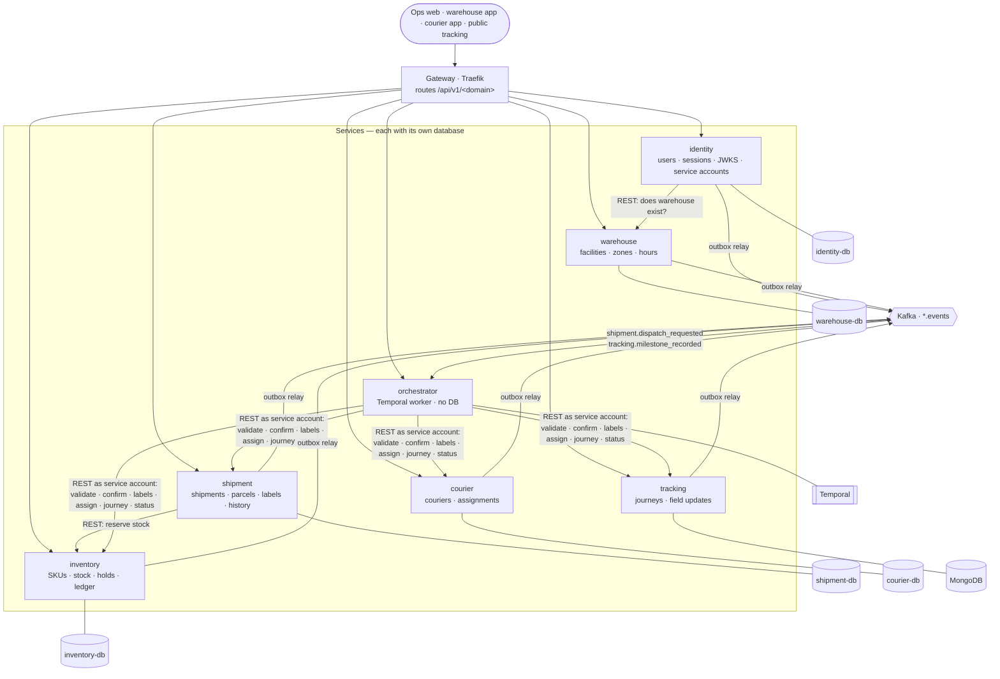

# SmartLogistics — Microservices

Backend for TransFleet's supply-chain and delivery orchestration platform, rebuilt
from the Phase 1 modular monolith into independently deployable services. The
monolith lives on in git history (the `phase_1` branch) for reference.

Each service owns an **isolated database instance**, verifies tokens on its own,
and talks to the others only through **REST** (immediate questions), **Kafka
events** (facts others react to) and **Temporal workflows** (multi-step processes
that must finish or be undone: dispatch and delivery).

## Architecture



| Service | Owns | Publishes | Consumes | Calls |
|---|---|---|---|---|
| **identity** | users, refresh tokens, operator↔warehouse scopes, service clients | `user.*` | `warehouse.deleted` (drop scopes), `courier.*` (link logins) | warehouse |
| **warehouse** | warehouses, zones, operating hours | `warehouse.*` (full snapshots) | — | — |
| **inventory** | SKUs, stock positions, holds, stock ledger, warehouse replica | `stock.*` | `warehouse.*`, `shipment.created`, `shipment.status_changed` | — |
| **shipment** | shipments, items, parcels, PDF labels, status history, warehouse replica | `shipment.*` incl. `dispatch_requested` | `warehouse.*`, `courier.assigned/unassigned` | inventory |
| **courier** | couriers, assignments, warehouse replica | `courier.*` incl. `assigned/unassigned` | `warehouse.*`, `shipment.status_changed` (end assignments) | — |
| **tracking** | journeys and field updates (MongoDB) | `tracking.milestone_recorded` | `courier.assigned`, `shipment.status_changed` (returns) | — |
| **orchestrator** | workflow state (in Temporal) | — | `shipment.dispatch_requested`, `tracking.milestone_recorded` | shipment, inventory, courier, tracking |

Notification and analytics services arrive in Week 3; the AI assistant and indexer
in Weeks 4–5. The full plan is in the *Microservices Migration Plan* doc.

## How the hard parts work

**Authentication.** Identity signs RS256 access tokens whose claims carry role,
warehouse scope and courier id. Every other service fetches Identity's public key
from `/.well-known/jwks.json` once, caches it, and verifies tokens locally. Background
work uses a **service account**: the orchestrator exchanges its client id and secret
for a 5-minute `system` token at `/api/v1/auth/service-token`, renewed automatically.

**Creating a shipment (reserve, then record).** Shipment checks the origin warehouse
against its local replica, calls Inventory to hold the stock, then records the
shipment, items, history and a `shipment.created` outbox row in one transaction.
Inventory confirms the hold from that event; a failed record releases the hold.

**Dispatching (Temporal saga).**
1. `POST /api/v1/shipments/{id}/dispatch` moves a `ready_for_dispatch` shipment with
   at least one package to `dispatching` and stages `shipment.dispatch_requested`.
   A second click gets `409`.
2. The orchestrator starts `DispatchWorkflow` (id `dispatch-{shipment}-{attempt}`;
   Temporal rejects a duplicate) and runs: validate → confirm the stock hold → print
   PDF labels → **assign a courier** (same city, home warehouse first, least loaded;
   waits and retries when nobody is free) → open the tracking journey → mark
   `dispatched`. Inventory commits the stock when it sees `dispatched`.
3. Any step that fails for good undoes the earlier ones in reverse (close the journey,
   release the courier) and marks the shipment `dispatch_failed` with the reason. The
   stock hold is kept; set it `ready_for_dispatch` and dispatch again (attempt 2).

**Delivering.** The dispatch workflow hands over to `DeliveryWorkflow`. Couriers post
updates to tracking (one at a time or a batch after being offline, each with its own
`event_id`, so retries are harmless). Tracking forwards milestones to the workflow,
which ignores duplicates and stale reports, fills gaps (`out_for_delivery` straight
after `dispatched` applies `picked_up` and `in_transit` first), and is the only writer
of post-dispatch status — those statuses are reserved to the `system` role. An overdue
pickup is reassigned to another courier; after the last failed attempt a return starts.

**Consistency.** Every event is written to an outbox in the same transaction as the
change (in tracking, each event document is its own outbox entry) and relayed to
Kafka. Consumers record the event id in the same transaction as their effect, so
redelivery is a no-op. Write endpoints accept `Idempotency-Key`. Shipments use real
optimistic locking; stock rows are locked in id order; couriers are picked with
`FOR UPDATE SKIP LOCKED` and a partial unique index allows one active assignment per
shipment.

**No foreign keys across services.** References are plain ids. Display fields are
snapshotted; cascades became events.

## Run it

One developer CLI does everything, on every OS.

**Prerequisites:** [uv](https://docs.astral.sh/uv/getting-started/installation/)
(it installs Python for you) and Docker Desktop, or Docker Engine with the Compose
plugin. Free ports: 5441–5445, 7233, 8233, 27017, 29092, 16686, and 8001–8007
(option A) or 8000/8080 (option B).

| macOS / Linux | Windows PowerShell | Windows cmd |
|---|---|---|
| `./dev.sh <command>` | `.\dev.ps1 <command>` | `dev <command>` |

### Option A — services on your machine, infrastructure in Docker (best for coding)

```bash
./dev.sh setup        # install the workspace + generate Identity's signing key
./dev.sh infra up     # 5 Postgres (5441-5445), Kafka, Temporal (7233, UI 8233), MongoDB, Jaeger, gateway (8000)
./dev.sh migrate      # every SQL service; or: ./dev.sh migrate shipment courier
./dev.sh seed         # warehouses, users, SKUs and stock, couriers — in the right order
./dev.sh start        # 7 APIs (8001-8007) + workers in one terminal; Ctrl+C stops all
```

The gateway runs on :8000 and forwards to the services on your machine, so
`http://localhost:8000` and the Swagger UI at `/docs` work in both options.

`start --reload` restarts a service when its code changes, `start shipment courier`
runs a subset, and `start --no-workers` skips the workers (no events, no workflows).
`./dev.sh status` shows every service's health; `./dev.sh reset` rolls back,
migrates and re-seeds.

### Option B — everything in Docker

```bash
./dev.sh docker up    # builds the images; databases, Kafka, Temporal, MongoDB, gateway on :8000
./dev.sh docker seed
./dev.sh docker logs orchestrator   # docker ps | migrate | down [-v]
```

### Try a dispatch

```bash
login() { curl -s localhost:8000/api/v1/auth/login -H 'content-type: application/json' \
  -d "{\"email\":\"$1\",\"password\":\"SmartLogistics!2026\"}" | jq -r .access_token; }
ADMIN=$(login admin@transfleet.com)
# create a shipment in Swagger (or docs/curl), then, with its id in $SID:
curl -s -X PATCH localhost:8000/api/v1/shipments/$SID/status -H "Authorization: Bearer $ADMIN" \
  -H 'content-type: application/json' -d '{"status":"ready_for_dispatch"}'
curl -s -X POST localhost:8000/api/v1/shipments/$SID/packages -H "Authorization: Bearer $ADMIN" \
  -H 'content-type: application/json' -d '{"weight_g":1500}'
curl -s -X POST localhost:8000/api/v1/shipments/$SID/dispatch -H "Authorization: Bearer $ADMIN" | jq
```

Watch the workflow at http://localhost:8233, or `GET /api/v1/dispatches/{workflow_id}`.
Then sign in as the assigned courier (`courier.one@` or `courier.three@` for Karachi)
and post `picked_up`, `out_for_delivery`, `delivered` to `/api/v1/tracking/updates`.

## API docs

**All APIs in one place: http://localhost:8000/docs** — one Swagger UI with a dropdown
per service. Authorize once and the token is kept as you switch services.

| URL / file | What |
|---|---|
| http://localhost:8000/docs | Swagger UI for every service, behind the gateway |
| http://localhost:8000 | Gateway: every API under `/api/v1/...` |
| http://localhost:800{1..7}/docs | One service's own Swagger UI, bypassing the gateway |
| `docs/curl/index.html` | Offline reference: every endpoint (82) with a copy-ready curl command |
| `docs/curl/openapi.json` | All specs merged into one, for Postman, Insomnia or Bruno |
| `docs/curl/*.postman_*.json` | Postman collection (a folder per service) and environment |
| http://localhost:8233 | Temporal UI: every dispatch and delivery workflow, step by step |
| http://localhost:8080 | Traefik dashboard |
| http://localhost:16686 | Jaeger traces |
| `docker compose --profile tools up -d kafka-ui` → :8090 | Kafka UI |

Seeded accounts (password `SmartLogistics!2026`): `admin@`, `support.lead@`,
`wh.karachi@`, `wh.lahore@`, `wh.regional@`, `courier.one@` … `courier.four@`
`@transfleet.com`. Couriers CR-0001/CR-0003 (Karachi) and CR-0002 (Lahore) are available.

## Develop and test

```bash
./dev.sh test          # platform unit tests, each service's suite, cross-service e2e
./dev.sh test courier  # one service
./dev.sh lint          # ruff + import-linter (services may never import each other)
./dev.sh check         # lint + `alembic check` per SQL service
```

Tests need the infrastructure from `./dev.sh infra up`: Postgres (or one server via
`SL_PG_HOST=localhost:5432`), MongoDB on `MONGO_URL` for tracking and e2e, and the
Temporal CLI for orchestrator and e2e — downloaded by the SDK on first run, or point
`TEMPORAL_CLI_PATH` at a `temporal` binary.

`tests/e2e` loads every service into one process, each on its own store, joined by an
in-memory event bus in place of Kafka, with a real Temporal dev server: it runs
dispatch and delivery end to end, including the no-courier failure and retry.

## Command reference

Swap `./dev.sh` for `.\dev.ps1` (PowerShell) or `dev` (cmd). `[svc ...]` means any
of `identity warehouse inventory shipment courier orchestrator tracking`.

| Command | What it does | make alias |
|---|---|---|
| `setup` | `uv sync --all-packages` + generate the signing key | `make setup` |
| `keys` | generate `infra/keys/jwt-private.pem` (skipped if it exists) | `make keys` |
| `infra up` / `down` / `status` | start / stop / list databases, Kafka, Temporal, MongoDB, Jaeger, gateway, Swagger UI | `make infra-up` / `infra-down` |
| `migrate [svc ...]` | `alembic upgrade head` per SQL service | `make migrate s="shipment"` |
| `migrate --down [svc ...]` | roll every migration back | — |
| `seed` | seed warehouse → identity → inventory → courier | `make seed` |
| `reset` | migrate down, migrate up, seed | `make reset` |
| `start [svc ...]` | APIs on 8001–8007 + workers; `--reload`, `--no-workers` | `make start s=shipment` |
| `status` | `/health` of every service | `make status` |
| `docs` | regenerate `docs/curl` and `docs/database.md` from the code | `make docs` |
| `docker up` / `down [-v]` / `ps` / `logs [svc]` / `migrate` / `seed` | the whole stack in Docker | `make up` … |
| `test [svc ...]` | platform tests, service suites, e2e (only when no service is named) | `make test s=shipment` |
| `lint` / `check` | ruff + import-linter / plus `alembic check` | `make lint` / `make check` |

## Configuration

Each service reads environment variables (or a `.env` file — see `.env.example`).
You normally set none of them: the defaults point at the Compose ports, and
`./dev.sh start` fills in the rest per service.

| Variable | Used by | Default / meaning |
|---|---|---|
| `DATABASE_URL` | SQL services | its own database on `localhost:5441`–`5445` |
| `KAFKA_BOOTSTRAP_SERVERS` | every service | `localhost:29092` (containers use `kafka:9092`) |
| `JWT_PRIVATE_KEY_FILE` | identity | `infra/keys/jwt-private.pem` (a Docker secret in Compose) |
| `JWKS_URL` | all but identity | `http://localhost:8001/.well-known/jwks.json` |
| `SERVICE_CLIENTS` | identity | JSON `{"client_id": "secret"}` of service accounts |
| `SERVICE_CLIENT_ID` / `SERVICE_CLIENT_SECRET` | orchestrator | its service account |
| `*_SERVICE_URL` | callers | e.g. `INVENTORY_SERVICE_URL=http://localhost:8003` |
| `TEMPORAL_ADDRESS` / `TASK_QUEUE` | orchestrator | `localhost:7233` / `smartlogistics-dispatch` |
| `COURIER_WAIT_ATTEMPTS` / `COURIER_WAIT_SECONDS` | orchestrator | look for a courier 5 times, 60 s apart, before failing the dispatch |
| `PICKUP_TIMEOUT_SECONDS` / `MAX_DELIVERY_ATTEMPTS` | orchestrator | reassign after this long without pickup / return after this many failures |
| `MONGO_URL` / `MONGO_DATABASE` | tracking | `mongodb://localhost:27017` / `tracking` |
| `OTEL_EXPORTER_OTLP_ENDPOINT` | every service | unset = no tracing export |
| `RUN_MIGRATIONS` / `RUN_SEED` | container entrypoint | migrate / seed before starting |
| `SL_PG_HOST` | dev CLI and tests | e.g. `localhost:5432` to put every database on one server |
| `TEMPORAL_CLI_PATH` | tests | a local `temporal` binary instead of the SDK download |
| `SL_BIND_HOST` | `./dev.sh start` | `0.0.0.0` on Linux (so the gateway container can reach the APIs), `127.0.0.1` elsewhere |

## Troubleshooting

- **`./dev.sh: Permission denied`** — run `chmod +x dev.sh` once.
- **PowerShell refuses to run `dev.ps1`** — use `dev` (cmd wrapper) or
  `Set-ExecutionPolicy -Scope CurrentUser RemoteSigned`.
- **"port is already allocated"** — another Postgres, Kafka, MongoDB or app is using
  the port; stop it.
- **`start` says an API port is taken** (`Address already in use`) — `start` names what
  holds it. A Docker container means the full Docker stack is still running its APIs (they
  restart with Docker): `./dev.sh infra up` removes them and keeps the infrastructure. A
  process is usually a server left over from an earlier run: `kill` every PID listed.
- **Every request is `401`** — the services couldn't fetch Identity's JWKS. Check
  `./dev.sh status`; if you regenerated the signing key, restart all services.
- **A dispatch stays in `dispatching`** — the orchestrator worker or Temporal isn't
  running (`start` warns when Temporal is down), or Kafka isn't, so the request event
  never arrived. Check `./dev.sh status` and http://localhost:8233.
- **Tracking returns 503** — MongoDB isn't running: `./dev.sh infra up`.
- **`localhost:8000` returns `502`** — the service behind that path isn't running.
- **Workers keep reconnecting** — Kafka isn't running: `./dev.sh infra up`.
- **Want a clean slate** — `./dev.sh reset` (local) or `./dev.sh docker down -v`.

## Repository layout

```
libs/sl-platform/      shared plumbing only: auth, service tokens, db, idempotency, outbox,
                       consumer, service client, app factory, worker runner, test helpers
services/<name>/
  src/<name>/          config, db, models, schemas, repository, services/, api/,
                       events.py (publish + consume), main.py (HTTP), worker.py, seed.py
  migrations/          the service's own Alembic chain (SQL services)
  tests/
services/orchestrator/src/orchestrator/
  workflows/           DispatchWorkflow, DeliveryWorkflow (deterministic)
  activities.py        every call to another service
  trigger.py           Kafka → start workflows / signal deliveries
infra/gateway/ · infra/docker/ · infra/temporal/   gateway routes, Dockerfile, Temporal config
scripts/               dev CLI, API and database doc generators
docker-compose.yml     databases, Kafka, Temporal, MongoDB, gateway, Swagger UI, Jaeger, APIs + workers
tests/e2e/             cross-service flows, real workflows
docs/                  architecture, PRD, database reference, ADRs, build logs
```

## Documentation

Start with [docs/documentation-guide.pdf](docs/documentation-guide.pdf): one page that says
where to look for what.

| Document | What's there |
|---|---|
| [docs/ARCHITECTURE.md](docs/ARCHITECTURE.md) | Services, communication, data, consistency, security, workflows; §1.1 maps every requirement to its status |
| [docs/PRD.md](docs/PRD.md) | Use cases, requirements, milestones, traceability matrix |
| [docs/database.md](docs/database.md) | Every service's tables and the tracking collections — generated by `./dev.sh docs` |
| [docs/adr/](docs/adr/) | 18 architecture decision records |
| [docs/phase_1.md](docs/phase_1.md) · [docs/phase_2.md](docs/phase_2.md) | Week 1 and Week 2 build logs |
| [docs/curl/](docs/curl/) | Generated API collection (see [API docs](#api-docs)) |
| [docs/projectDocs/](docs/projectDocs/) | The assignment briefs, unmodified |

## Tech stack

Python 3.13 · FastAPI · SQLAlchemy 2 (async) · PostgreSQL 16 (one per service) ·
Alembic · Kafka (KRaft) via aiokafka · Temporal · MongoDB 7 (PyMongo async) ·
PyJWT (RS256/JWKS) · Argon2 · httpx · ReportLab (labels) · Traefik ·
OpenTelemetry → Jaeger · uv workspace · Ruff · import-linter · pytest · Docker Compose.
Coming next: Celery + RabbitMQ, Schema Registry, Redis, Prometheus + Grafana,
LangGraph + Qdrant.
