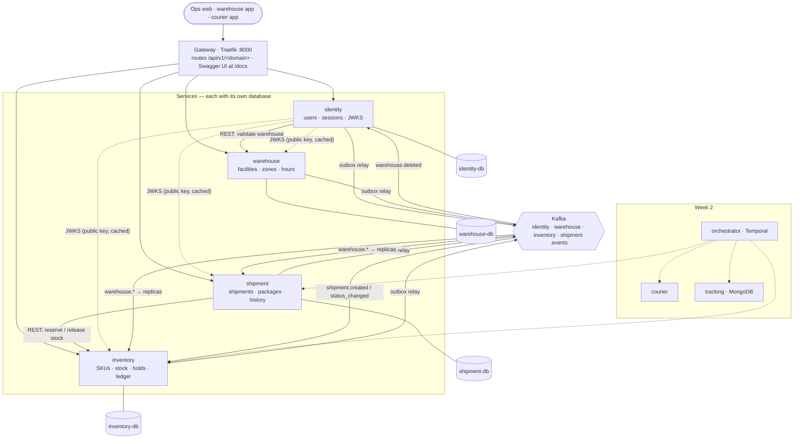
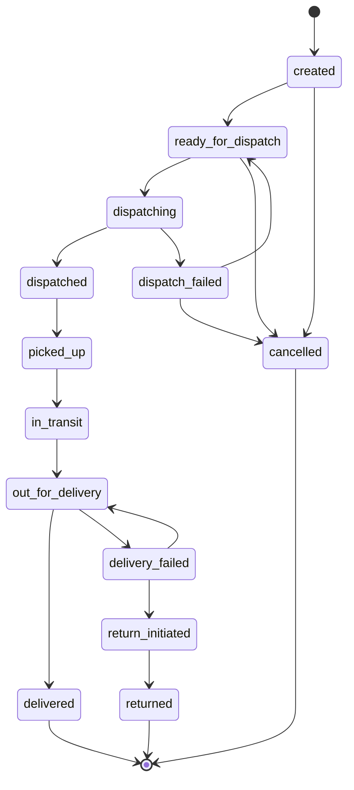
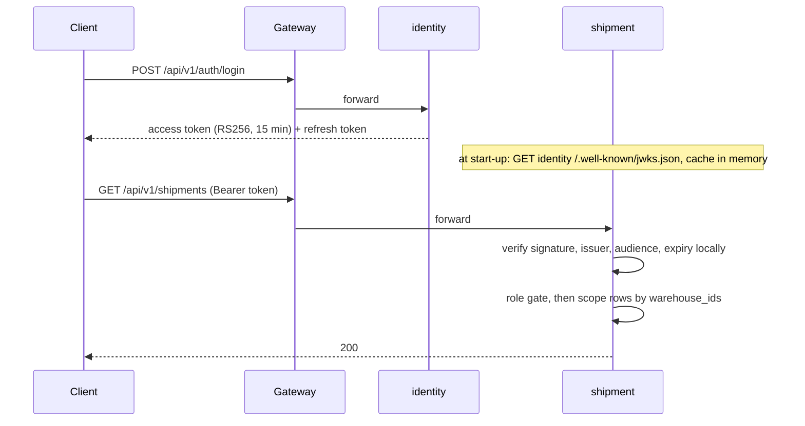
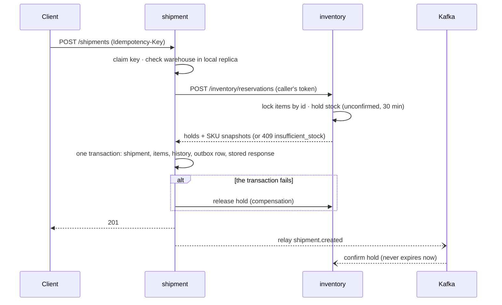

# SmartLogistics — Technical Architecture

**Project:** SmartLogistics — Intelligent Supply Chain & Delivery Orchestration Platform
**Client:** TransFleet
**Component:** Backend platform (Part A) + GenAI layer (Part B)
**Status:** Week 1 complete (microservices foundation) · Week 2 designed
**Last updated:** 2026-10-12

> This document describes the **microservices** architecture on the `microservices` branch.
> The Phase 1 modular monolith and its architecture document live on the `phase_1` branch.

---

## Table of Contents

1. [Purpose and Scope](#1-purpose-and-scope) · [1.1 Requirement coverage](#11-requirement-coverage)
2. [Architectural Drivers](#2-architectural-drivers)
3. [System Context](#3-system-context)
4. [Services and Ownership](#4-services-and-ownership)
5. [Communication](#5-communication)
6. [Data Architecture](#6-data-architecture)
7. [Shipment Lifecycle and State Machine](#7-shipment-lifecycle-and-state-machine)
8. [Key Flows](#8-key-flows)
9. [Consistency and Idempotency](#9-consistency-and-idempotency)
10. [API and Security](#10-api-and-security)
11. [Observability](#11-observability)
12. [Week 2 Design — Dispatch and Delivery](#12-week-2-design--dispatch-and-delivery)
13. [Part B — GenAI Layer](#13-part-b--genai-layer)
14. [Runtime Topology](#14-runtime-topology)
15. [Repository Layout](#15-repository-layout)
16. [Architecture Decision Records](#16-architecture-decision-records)
17. [Non-Functional Targets](#17-non-functional-targets)
18. [Assumptions, Open Questions and Risks](#18-assumptions-open-questions-and-risks)
19. [Delivery Roadmap](#19-delivery-roadmap)

---

## 1. Purpose and Scope

This is the reference for service boundaries, data ownership, how services communicate,
consistency guarantees and observability. Product requirements, use cases and the
feature-to-deliverable traceability the brief asks for are in [PRD.md](PRD.md); the database
reference is [database.md](database.md); each significant decision has an ADR in [adr/](adr/).

**In scope:** shipment lifecycle, warehouse and inventory operations, dispatch orchestration,
courier assignment, tracking and delivery, returns, notifications, analytics, and the GenAI
assistant layer.

**Out of scope:** frontend applications, real carrier/EDI integrations, payments, production
cloud infrastructure, and route optimisation against live map data. External providers are
represented by mock adapters behind stable interfaces.

### 1.1 Requirement coverage

Every functional requirement in *SmartLogistics — Part A*, with its status at the end of
Week 1. Status means **built and verified by tests**, not designed.

| # | Requirement (Part A) | Where | Status |
|---|---|---|---|
| **1** | Shipment, package, address and metadata management | shipment service, [§7](#7-shipment-lifecycle-and-state-machine) | ✅ Built |
| | User registration with four roles | identity service, [§10](#10-api-and-security) | ✅ Built: role gate plus per-warehouse scoping, enforced in every service |
| | Courier profile management and availability | courier service, [§12.2](#122-courier-service) | 🟡 `courier_id` carried on users, tokens and shipments; the courier service is Week 2 |
| | Shipment history and audit trail | `shipment_status_history`, `stock_movements` | ✅ Built: one immutable row per transition and per stock change |
| | Consistency across dependent systems | [§9](#9-consistency-and-idempotency) | ✅ Outbox events, replicas, reserve-then-record with compensation |
| **2** | Dispatch workflow: validate, reserve, label, assign, track, mark dispatched | [§12.1](#121-dispatch-workflow) | 🟡 State machine, stock holds and commit-on-dispatch built; the Temporal saga is Week 2 |
| | Partial failures must not corrupt shipment state | [ADR-004](adr/ADR-004-synchronous-calls-reserve-then-record.md), [ADR-010](adr/ADR-010-temporal-orchestration.md) | 🟡 Shipment creation compensates on failure; dispatch saga Week 2 |
| **3** | Delivery workflow: pickup, updates, attempts, confirmation | [§12.3](#123-delivery-workflow-and-tracking) | 🟡 All delivery transitions and attempt counting built; workflow and tracking service Week 2 |
| | Idempotent retries, duplicate prevention | [ADR-007](adr/ADR-007-layered-idempotency.md) | ✅ `Idempotency-Key` per caller with leases, deterministic ids, consumer dedupe |
| | High-volume field updates, real-time visibility | tracking service | 🔴 Week 2 |
| **4** | Event-driven behaviours: traceable, recoverable, no double-processing | [§5.2](#52-asynchronous-kafka-events) | ✅ Kafka with transactional outbox and per-consumer dedupe; 🔴 dead-letter topic and Schema Registry Week 3 |
| **5** | Analytics metrics (nine listed) | analytics service | 🔴 Week 3 |
| **6** | Observability and failure diagnosis | [§11](#11-observability) | 🟡 Structured logs with request ids, health/readiness probes, OpenTelemetry traces to Jaeger; metrics and dashboards Week 3 |

**Tech stack**, as mandated by the brief:

| Layer | Required | Status |
|---|---|---|
| Backend | Python, FastAPI, PostgreSQL, NoSQL, Redis | ✅ Python 3.13, FastAPI, PostgreSQL 16 (one per service). 🔴 MongoDB (tracking) Week 2, Redis (token denylist, caching) Week 3 |
| Async | Celery + RabbitMQ, Kafka + Schema Registry, Temporal | ✅ Kafka (KRaft) with outbox. 🔴 Temporal Week 2; Celery, RabbitMQ and Schema Registry Week 3 |
| Observability | Prometheus, Grafana, Jaeger, OpenTelemetry | ✅ OpenTelemetry → Jaeger. 🔴 Prometheus and Grafana Week 3 |
| DevOps | Docker, Docker Compose | ✅ One image recipe for every service, Compose stack, cross-platform dev CLI |

Nothing in the mandated stack is substituted; 🔴 items are scheduled ([§19](#19-delivery-roadmap)).

---

## 2. Architectural Drivers

| # | Driver | Source | Response |
|---|---|---|---|
| D1 | **Services must be independently deployable and own their data** | Manager requirement | Database per service, no cross-service foreign keys, boundaries enforced by import-linter ([ADR-001](adr/ADR-001-microservices-database-per-service.md), [ADR-013](adr/ADR-013-monorepo-shared-platform.md)) |
| D2 | **Partial failures must not corrupt state** | Dispatch workflow | Reserve-then-record with compensation; Temporal sagas from Week 2 ([ADR-004](adr/ADR-004-synchronous-calls-reserve-then-record.md), [ADR-010](adr/ADR-010-temporal-orchestration.md)) |
| D3 | **Inventory must stay consistent** | Problem statement | All stock rules in one database, enforced by constraints and ordered row locks ([ADR-008](adr/ADR-008-concurrency-control.md), [ADR-009](adr/ADR-009-inventory-hold-lifecycle.md)) |
| D4 | **Events are delayed, duplicated or lost between systems** | Problem statement | Transactional outbox, at-least-once delivery, idempotent consumers ([ADR-005](adr/ADR-005-transactional-outbox-kafka.md), [ADR-007](adr/ADR-007-layered-idempotency.md)) |
| D5 | **One service's outage must not cascade** | Reliability goals | Local token verification, local replicas, timeouts and circuit breakers ([ADR-003](adr/ADR-003-token-verification-jwks.md), [ADR-006](adr/ADR-006-event-carried-state-replicas.md)) |
| D6 | **Peaks and high concurrent updates** | Scalability goals | API and worker processes scale separately; high-volume tracking off the transactional databases ([ADR-011](adr/ADR-011-mongodb-tracking.md)) |
| D7 | **Failures must be diagnosable across hops** | Observability expectations | Request ids, trace context on service calls, Jaeger; metrics and dashboards Week 3 |

---

## 3. System Context



---

## 4. Services and Ownership

Each service is a FastAPI **API process** plus a **worker process** (outbox relay and Kafka
consumers), built from the same image and scaled separately.

| Service | API port | Database | Owns | Publishes | Consumes | Calls |
|---|---|---|---|---|---|---|
| **identity** | 8001 | identity-db :5441 | Users, refresh tokens, operator↔warehouse scopes, signing key | `user.*` | `warehouse.deleted` (drop scopes) | warehouse (validate an assignment) |
| **warehouse** | 8002 | warehouse-db :5442 | Warehouses, zones, operating hours | `warehouse.*` (full snapshots) | — | — |
| **inventory** | 8003 | inventory-db :5443 | SKUs, stock positions, holds, stock ledger, warehouse replica | `stock.*` | `warehouse.*`, `shipment.created` (confirm hold), `shipment.status_changed` (commit / release) | — |
| **shipment** | 8004 | shipment-db :5444 | Shipments, items, packages, addresses, status history, warehouse replica | `shipment.*` | `warehouse.*` | inventory (reserve, release) |

Why the boundaries fall here is in [ADR-002](adr/ADR-002-service-boundaries.md). Week 2 adds
**courier**, **orchestrator** and **tracking** ([§12](#12-week-2-design--dispatch-and-delivery)).

**Shared code without shared runtime.** `libs/sl-platform` holds plumbing only (auth
verification, database helpers, idempotency, outbox, consumer, service client, app factory,
worker runner, telemetry). import-linter fails the build if a service imports another service
or the platform imports a service.

---

## 5. Communication

### 5.1 Synchronous (REST)

Used only when the caller cannot continue without the answer
([ADR-004](adr/ADR-004-synchronous-calls-reserve-then-record.md)).

| Caller → callee | Call | Why it is synchronous |
|---|---|---|
| shipment → inventory | `POST /inventory/reservations`, `/{shipment_id}/release` | A shipment must not exist without its stock |
| identity → warehouse | `GET /warehouses/{id}` | An operator cannot be scoped to a warehouse that does not exist |
| every service → identity | `GET /.well-known/jwks.json` | At start-up (best effort), then when the cache is an hour old or a token has an unknown `kid`; never per request |

Every call goes through `ServiceClient`: 3 s timeout; up to 2 retries, only for reads or writes
carrying an `Idempotency-Key`; a circuit breaker that opens after 5 consecutive failed attempts
and lets calls through again after 30 s (while open → `503 upstream_unavailable`); the
caller's bearer token and W3C `traceparent` forwarded. A callee's 4xx/5xx answer (for example
`409 insufficient_stock`) reaches the client unchanged; 502/503/504 and timeouts are retried
and then reported as `503 upstream_unavailable`.

### 5.2 Asynchronous (Kafka events)

Every event is written to the producing service's `outbox_events` table in the same
transaction as the change and relayed by its worker
([ADR-005](adr/ADR-005-transactional-outbox-kafka.md)). One topic per producer, keyed by
aggregate id so one entity's events stay ordered.

| Topic | Event types | Consumed by |
|---|---|---|
| `identity.events` | `user.created`, `.updated`, `.role_changed`, `.status_changed`, `.scope_changed`, `.deleted`, `.restored` | (analytics, notifications — Week 3) |
| `warehouse.events` | `warehouse.created`, `.updated`, `.status_changed`, `.deleted`, `.restored` — full snapshots | inventory, shipment (replicas), identity (`deleted`) |
| `inventory.events` | `stock.reserved`, `.committed`, `.released`, `.adjusted` | (analytics — Week 3) |
| `shipment.events` | `shipment.created`, `.updated`, `.status_changed` | inventory (confirm / commit / release) |

Envelope: `event_id`, `event_type`, `version`, `occurred_at`, `producer`, `payload`.
Consumers record `event_id` in `processed_events` with their effect, so redelivery is a
no-op. A handler that keeps failing gets 5 attempts with backoff; after that the event is
logged with its id and **skipped** (its offset is committed), so it needs a manual replay. The
dead-letter topic in Week 3 replaces this. If Kafka is down, workers wait with backoff and
the outbox holds every event.

---

## 6. Data Architecture

**One PostgreSQL 16 instance per service**; no service holds another's credentials. Full
table reference, generated from the models: [database.md](database.md).

| Pattern | Where | Decision |
|---|---|---|
| **Plain-id references** | `warehouse_id`, `shipment_id`, `sku_id`, `courier_id` across services | No foreign keys between services ([ADR-001](adr/ADR-001-microservices-database-per-service.md)) |
| **Local replicas** | `warehouse_refs` in inventory and shipment | Built from `warehouse.*` snapshots, newest-wins on `source_updated_at` ([ADR-006](adr/ADR-006-event-carried-state-replicas.md)) |
| **Snapshots** | `origin_warehouse_code`, `sku_code`, `sku_name`, unit weight on shipment lines | Copied at write time; reads never call another service |
| **Events instead of cascades** | `warehouse.deleted` → identity removes scopes | ([ADR-006](adr/ADR-006-event-carried-state-replicas.md)) |
| **Platform tables** | `outbox_events`, `processed_events`, `idempotency_keys` in every database | Events and retries without distributed transactions |
| **Soft deletion and ledgers** | users, warehouses, zones, SKUs, shipments; `stock_movements`, `shipment_status_history` | ([ADR-014](adr/ADR-014-soft-deletion-audit-trail.md)) |

Each service has its own Alembic chain; `./dev.sh check` runs `alembic check` per service so a
model change without a migration fails the build.

From Week 2: **MongoDB** for tracking journeys ([ADR-011](adr/ADR-011-mongodb-tracking.md)),
**Temporal's own database** for workflow state.

---

## 7. Shipment Lifecycle and State Machine

Declared once, in `services/shipment/src/shipment/state_machine.py`; every transition is
validated there and recorded in `shipment_status_history` with actor, role and reason.



| Into status | Who may move it there today | From Week 2 |
|---|---|---|
| `ready_for_dispatch` | admin, warehouse operator | unchanged |
| `dispatching`, `dispatched`, `dispatch_failed` | admin | dispatch workflow only (`system`) |
| `picked_up` → `delivered`, `delivery_failed` | admin, courier | delivery workflow, from courier updates via tracking |
| `return_initiated` | admin, customer support | unchanged, plus automatic after 3 failed attempts |
| `returned` | admin, warehouse operator | unchanged |
| `cancelled` | admin, customer support | unchanged |

- Contents are editable only in `created`, `ready_for_dispatch`, `dispatch_failed`.
- **No `dispatched → cancelled`**: goods that left the warehouse come back as a return
  (Phase 1 allowed it and lost the stock).
- Stock effects follow by event: `dispatched` commits the hold, `cancelled` releases it.

---

## 8. Key Flows

### 8.1 Authenticated request



No service calls identity per request; a restarted pod refetches the JWKS
([ADR-003](adr/ADR-003-token-verification-jwks.md)).

### 8.2 Create a shipment (reserve, then record)



### 8.3 Dispatch and cancel (stock follows by event)

`PATCH /shipments/{id}/status` to `dispatched` publishes `shipment.status_changed`; inventory
commits the hold (on-hand and reserved both drop, a ledger row is written). `cancelled`
releases it. Both handlers are idempotent. From Week 2 the dispatch workflow drives this
([§12.1](#121-dispatch-workflow)).

---

## 9. Consistency and Idempotency

| Concern | Mechanism | ADR |
|---|---|---|
| Change + event atomicity | Transactional outbox, relay with `FOR UPDATE SKIP LOCKED` | [005](adr/ADR-005-transactional-outbox-kafka.md) |
| Duplicate events | `processed_events` per consumer, in the effect's transaction | [005](adr/ADR-005-transactional-outbox-kafka.md) |
| Client retries | `Idempotency-Key` per (caller, key), 60 s lease, 24 h replay, recorded atomically | [007](adr/ADR-007-layered-idempotency.md) |
| Double shipment on retry | Keyed shipment id = `uuid5(owner:key)` | [007](adr/ADR-007-layered-idempotency.md) |
| Concurrent shipment updates | Optimistic `version_id_col` → `409 concurrent_update` | [008](adr/ADR-008-concurrency-control.md) |
| Last-unit stock races | Row locks in id order; check constraints forbid negative or over-reserved stock | [008](adr/ADR-008-concurrency-control.md) |
| Leaked holds | Unconfirmed holds expire after 30 min; confirmed holds never | [009](adr/ADR-009-inventory-hold-lifecycle.md) |
| Stale replicas | Newest-wins on `source_updated_at` | [006](adr/ADR-006-event-carried-state-replicas.md) |
| One request, one commit | Services flush; the endpoint commits once | [008](adr/ADR-008-concurrency-control.md) |

Two pods handling the same request at the same moment: the first claims the idempotency key,
the second gets `409 request_in_progress`; without a key, the database locks and constraints
decide, and Kafka delivery is deduplicated per consumer.

---

## 10. API and Security

- **One entry point**: Traefik on `:8000` routes by path prefix to the owning service;
  **one Swagger UI** for every service at `/docs`
  ([ADR-012](adr/ADR-012-edge-gateway-unified-docs.md)).
- **Tokens**: RS256 signed by identity, verified locally everywhere; refresh tokens stored
  hashed and rotated, replay revokes the user's sessions; lockout after 5 failed logins for
  15 minutes ([ADR-003](adr/ADR-003-token-verification-jwks.md)).
- **Authorisation in two layers**, enforced by each service: the **role** opens the route; the
  **scope** in the token (`warehouse_ids`, `courier_id`) narrows the rows. An operator sees
  only their warehouses' stock and shipments; a courier only their own shipments.
- **Errors** use one body in every service, `{code, message}` (plus `detail` with field
  errors on `422`), with a stable `code`
  (`insufficient_stock`, `concurrent_update`, `request_in_progress`,
  `upstream_unavailable`, …); database constraint violations map to specific messages through
  fixed constraint names.

| Role | Can do (summary) |
|---|---|
| admin | Everything, including user management |
| customer support | Create, update and cancel shipments (and the stock holds behind them); initiate returns; read stock and warehouses |
| warehouse operator | Within assigned warehouses: stock levels and adjustments, packages, `ready_for_dispatch`, `returned` |
| courier | Their own shipments: delivery transitions; warehouse locations |

Week 2 adds a `system` role for service accounts (the orchestrator), issued by identity as
short-lived tokens, and restricts dispatch and delivery transitions to it.

---

## 11. Observability

| Signal | Now | Week 3 |
|---|---|---|
| Logs | Structured (JSON in Docker), one line per request with `request_id` (`X-Request-ID` honoured and returned) | `trace_id` / `span_id` on every line |
| Traces | OpenTelemetry for FastAPI, httpx and SQLAlchemy, exported to **Jaeger** (:16686) when an OTLP endpoint is set; `traceparent` forwarded on service calls | Context carried through Kafka headers and Temporal activities |
| Health | `/health` (liveness, touches nothing) and `/health/ready` (checks the service's own database) on every service | — |
| Metrics | — | Prometheus: RED per route, outbox backlog age, consumer lag, workflow outcomes, the nine business metrics |
| Dashboards and alerts | — | Grafana: API health, pipeline health, business KPIs |

Diagnosis targets from the brief: dispatch workflows (Temporal UI from Week 2), courier
assignment and tracking updates (traces + workflow history), warehouse reservation (ledger +
traces), background workers (outbox backlog and consumer lag metrics).

---

## 12. Week 2 Design — Dispatch and Delivery

Decisions taken for Week 2: **MongoDB** for tracking, **real PDF labels**, **automatic courier
assignment with manual override**.

### 12.1 Dispatch workflow

`POST /shipments/{id}/dispatch` (admin, warehouse operator) moves the shipment to
`dispatching` and starts `DispatchWorkflow` with id **`dispatch-{shipment_id}`**; Temporal
rejects a second start, so a double-click cannot dispatch twice
([ADR-010](adr/ADR-010-temporal-orchestration.md)).

| Step | Activity (service) | Compensation |
|---|---|---|
| 1 | Validate shipment: status, packages, address (shipment) | — |
| 2 | Confirm the stock hold exists and is confirmed (inventory) | — (the hold is kept for a retry) |
| 3 | Generate one PDF label per package, with barcode (shipment) | — (labels are regenerated idempotently) |
| 4 | Assign a courier: available, same city as the warehouse, lowest load; rows locked with `SKIP LOCKED` (courier) | Release the assignment |
| 5 | Initialise the tracking journey (tracking) | Close the journey |
| 6 | Mark `dispatched` (shipment) → inventory commits the hold by event | — |

Each activity retries on its own and is idempotent (keyed by shipment id). A permanent failure
runs compensations in reverse and marks `dispatch_failed` with the reason; from there the
shipment can be retried or cancelled.

### 12.2 Courier service

PostgreSQL. Courier profiles linked to identity users by `courier_id`; vehicle, capacity
(maximum active shipments), home city/zone, availability (`offline`, `available`, `on_shift`).
APIs: profile CRUD (admin), availability (the courier themself), assignment and release
(orchestrator), **reassignment** (admin, customer support). One active assignment per shipment
(unique constraint). Publishes `courier.assigned`, `courier.unassigned`,
`courier.availability_changed`.

### 12.3 Delivery workflow and tracking

- Couriers post updates to **tracking** (`picked_up`, `in_transit`, `out_for_delivery`,
  location pings, delivery attempts with outcome). Each carries a client `event_id`; a unique
  index makes retries no-ops; ordering is by `occurred_at`
  ([ADR-011](adr/ADR-011-mongodb-tracking.md)).
- Tracking stores the journey and **signals** `DeliveryWorkflow`, which validates the
  transition and is the **only writer** of post-dispatch shipment status.
- Timers: escalate if not picked up within the configured window; after the **third** failed
  attempt, start a return.
- Tracking publishes `tracking.*` milestones for notifications and analytics (Week 3).

### 12.4 Infrastructure added

Temporal server (+ UI on :8233) with its own PostgreSQL, MongoDB, and three services added to
Compose, the gateway and `./dev.sh`.

---

## 13. Part B — GenAI Layer

The AI layer is a separate service with its own scaling profile (LLM latency, long-lived
streaming connections); a hung provider call must never affect dispatch traffic. It
integrates through Kafka and read-only queries.

- **Ingestion (Week 4):** an indexing consumer composes narrative documents from operational
  events (a shipment's lifecycle, exceptions and timings; periodic warehouse and courier
  summaries), embeds them and stores them with filterable metadata (`shipment_id`,
  `warehouse_id`, `courier_id`, `city`, `status`, `date`). Re-indexing is idempotent on
  `{entity_type, entity_id, version}`.
- **Assistant (Week 5):** a LangGraph agent with `semantic_search` (filtered retrieval),
  `metrics_query` (allow-listed read-only aggregates) and `shipment_lookup`, streamed over SSE.
  Requests carry the caller's token, so retrieval is scoped by the same rules as the REST API.
- **AI observability:** every interaction logged with retrieved context, latency, token usage
  and outcome; provider calls behind a timeout and circuit breaker.

---

## 14. Runtime Topology

| Component | Local port | Notes |
|---|---|---|
| Gateway (Traefik) | 8000 (dashboard 8080) | Docker labels in full-Docker mode; `infra/gateway/local.yml` when services run on the host |
| Swagger UI | 8000/docs | One page, a dropdown per service |
| identity · warehouse · inventory · shipment APIs | 8001 · 8002 · 8003 · 8004 | Each also has `/docs` |
| Workers | — | One per service: outbox relay + consumers |
| PostgreSQL ×4 | 5441–5444 | One container and volume per service |
| Kafka (KRaft) | 29092 (host) / 9092 (containers) | Kafka UI on 8090 with `--profile tools` |
| Jaeger | 16686 | OTLP on 4318 inside the network |

Two run modes ([ADR-016](adr/ADR-016-cross-platform-developer-cli.md)):

- **Services on the host** (`./dev.sh infra up` + `./dev.sh start --reload`): databases,
  Kafka, Jaeger, gateway and Swagger UI in Docker; APIs and workers as local processes with
  hot reload.
- **Everything in Docker** (`./dev.sh docker up`): one image built per service from
  `infra/docker/service.Dockerfile`; APIs migrate on start.

Production shape (not part of the assignment): each API and worker as its own Deployment,
scaled independently; Kafka, Temporal and PostgreSQL replicated.

---

## 15. Repository Layout

```
libs/sl-platform/            shared plumbing (no business rules)
services/<name>/
  src/<name>/                config, db, models, schemas, repository, services/, api/,
                             events.py, main.py (API), worker.py, seed.py
  migrations/                the service's own Alembic chain
  tests/
tests/e2e/                   all four services in one process, joined by an in-memory bus
infra/docker/                one Dockerfile for every service + entrypoint
infra/gateway/               gateway routes for local mode
scripts/                     dev CLI, API-collection and database-reference generators
docs/                        this document, PRD, database reference, ADRs, API collection
docker-compose.yml · dev.sh · dev.ps1 · dev.cmd · Makefile
```

---

## 16. Architecture Decision Records

| ADR | Decision | Status |
|---|---|---|
| [001](adr/ADR-001-microservices-database-per-service.md) | Microservices with a database per service | Accepted (supersedes the monolith) |
| [002](adr/ADR-002-service-boundaries.md) | Service boundaries | Accepted |
| [003](adr/ADR-003-token-verification-jwks.md) | RS256 tokens verified locally with JWKS | Accepted |
| [004](adr/ADR-004-synchronous-calls-reserve-then-record.md) | REST only where needed; reserve, then record | Accepted |
| [005](adr/ADR-005-transactional-outbox-kafka.md) | Transactional outbox to Kafka, consumer dedupe | Accepted |
| [006](adr/ADR-006-event-carried-state-replicas.md) | Event-carried state transfer, local replicas | Accepted |
| [007](adr/ADR-007-layered-idempotency.md) | Layered idempotency | Accepted |
| [008](adr/ADR-008-concurrency-control.md) | Concurrency control | Accepted |
| [009](adr/ADR-009-inventory-hold-lifecycle.md) | Inventory hold lifecycle | Accepted |
| [010](adr/ADR-010-temporal-orchestration.md) | Temporal for dispatch and delivery | Accepted, Week 2 |
| [011](adr/ADR-011-mongodb-tracking.md) | MongoDB for tracking journeys | Accepted, Week 2 |
| [012](adr/ADR-012-edge-gateway-unified-docs.md) | One gateway, one API portal | Accepted |
| [013](adr/ADR-013-monorepo-shared-platform.md) | Monorepo, shared platform library, enforced boundaries | Accepted |
| [014](adr/ADR-014-soft-deletion-audit-trail.md) | Soft deletion and immutable audit trail | Accepted |
| [015](adr/ADR-015-event-schemas-avro-deferred.md) | JSON envelopes now, Avro + Schema Registry Week 3 | Accepted |
| [016](adr/ADR-016-cross-platform-developer-cli.md) | One cross-platform developer CLI | Accepted |

---

## 17. Non-Functional Targets

| Attribute | Target | Verification |
|---|---|---|
| Throughput | 10,000 shipments/day sustained; 3× seasonal peak | Load test on create, dispatch and tracking paths (Week 3) |
| API latency | p95 < 150 ms reads, < 300 ms writes (excluding workflow completion) | Prometheus histograms (Week 3) |
| Tracking ingest | 500 updates/s sustained | Load test (Week 3) |
| Dispatch completion | p95 < 30 s end to end | Temporal metrics (Week 2–3) |
| Event lag | p95 < 5 s from commit to consumer effect | Consumer-lag metric (Week 3) |
| Fault isolation | One service or database down affects only the flows that need it | Stop each container in turn |
| Durability | No committed change or event lost on process crash | Outbox + Temporal; crash tests |
| Recoverability | Failed workflows retryable; failed events replayable | Temporal UI; dead-letter replay (Week 3) |
| Security | No secrets in code; mutations audited; scoping enforced in every service | Review + tests |

---

## 18. Assumptions, Open Questions and Risks

**Assumptions:** single region; single Kafka broker and Temporal cluster are acceptable for
the assignment (production needs replication); notification providers and route preparation
are mocks behind stable interfaces; currency, tax and billing are out of scope.

| Open question | Default if unanswered |
|---|---|
| Qdrant or pgvector for Part B? | Qdrant |
| Which LLM provider? | Provider-agnostic adapter |
| Is a real notification channel expected? | Mock adapters, logged and inspectable |
| Kubernetes manifests per service? | Not in Weeks 1–3; the monolith's manifests are on `phase_1` |

| Risk | Mitigation |
|---|---|
| Local stack breadth (≈15 containers by Week 3) slows development | Run modes and Compose profiles; `./dev.sh start` runs only what is asked |
| Temporal learning curve | Dispatch first as a walking skeleton, compensation second |
| Eventual consistency surprises (replicas, hold confirmation) | Documented windows; dispatch re-validates; e2e tests cover event paths |
| Test depth dropped in the rebuild (Phase 1 had ≈700 tests, now 115) | Every Week 2 feature lands with unit, workflow and e2e tests; coverage gate in Week 3 |
| Contract drift between services before the Schema Registry | Additive-only payload changes; consumer tests; Avro in Week 3 |

---

## 19. Delivery Roadmap

| Week | Delivered |
|---|---|
| **1** ✅ | Four services with isolated databases, platform library, outbox + Kafka, replicas, idempotency, state machine, gateway, unified Swagger, Compose, dev CLI, 115 tests |
| **2** | Service accounts; courier service; orchestrator with `DispatchWorkflow` (saga) and `DeliveryWorkflow`; tracking service on MongoDB; PDF labels; Temporal + MongoDB in Compose |
| **3** | Schema Registry + Avro, dead-letter topic, Celery + RabbitMQ (hold sweeper, notifications), analytics service and the nine metrics, Prometheus + Grafana, trace context through Kafka, Redis token denylist |
| **4** | Indexing consumer, document composition, embeddings, vector store, filtered retrieval |
| **5** | LangGraph assistant, tools, SSE streaming, AI observability |

Feature-level traceability is in [PRD.md §6](PRD.md#6-traceability).
