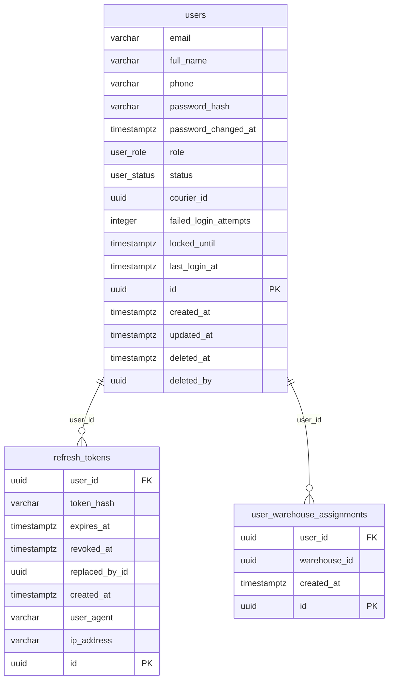
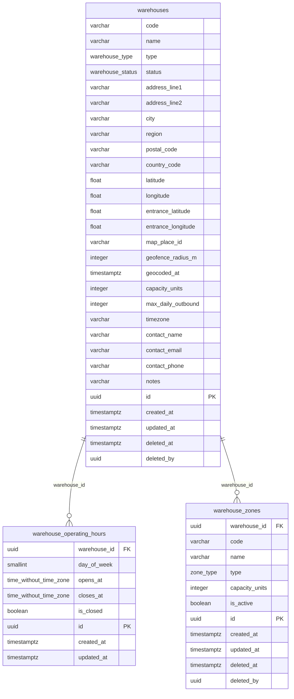
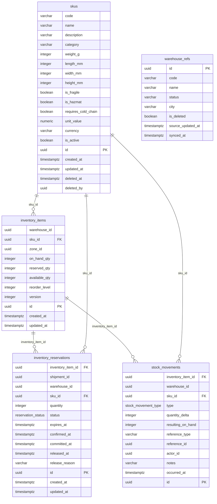
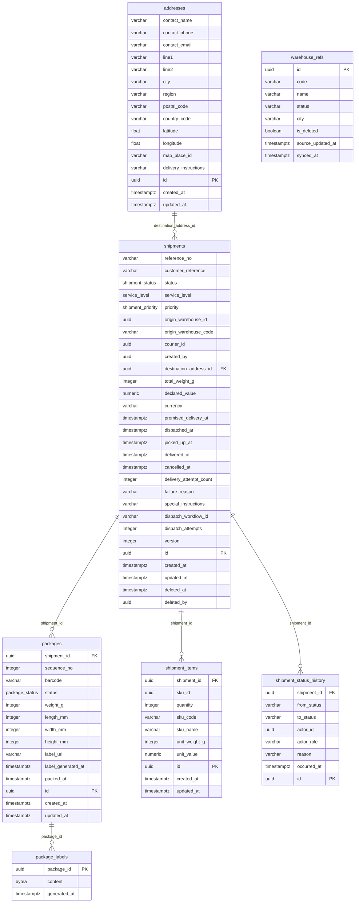
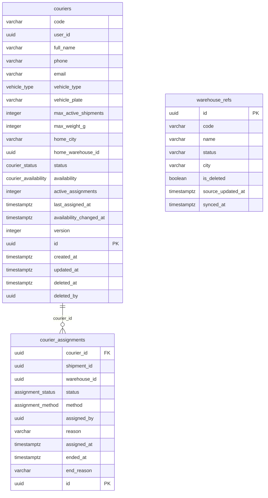

# Database Reference

**Engine:** PostgreSQL 16 · **Databases:** 5 (one per service) · **Service tables:** 21 · **Platform tables in each:** 3 · plus MongoDB for tracking ([below](#tracking-mongodb))
**Generated:** 2026-10-13 by `scripts/generate_db_docs.py` (`./dev.sh docs`). Do not edit by hand.

Generated from the SQLAlchemy models, which the Alembic migrations are checked against (`./dev.sh check`). Table descriptions are the model docstrings. Design rationale lives in [ARCHITECTURE.md](ARCHITECTURE.md) and the [ADRs](adr/).

---

## How the data is organised

**One isolated PostgreSQL instance per service** ([ADR-001](adr/ADR-001-microservices-database-per-service.md)). A service's tables are reachable only through its API and its events; no other service holds its credentials, and there are **no foreign keys between services**.

| Service | Database (local port) | Owns | Tables |
|---|---|---|---|
| **identity** | `identity-db` (:5441) | Accounts, sessions and operator warehouse scopes. | 3 |
| **warehouse** | `warehouse-db` (:5442) | Facilities, their zones and opening hours. | 3 |
| **inventory** | `inventory-db` (:5443) | The SKU catalog, stock positions, holds, the stock ledger, a warehouse replica. | 5 |
| **shipment** | `shipment-db` (:5444) | Shipments with their items, packages and audit trail, a warehouse replica. | 7 |
| **courier** | `courier-db` (:5445) | Courier profiles, shipment assignments with their history, a warehouse replica. | 3 |

### Conventions

| Convention | Detail |
|---|---|
| **Primary keys** | `uuid`, generated by the application: opaque, non-enumerable, and known before the insert (a keyed shipment's id is derived from its Idempotency-Key) |
| **Timestamps** | `timestamptz` everywhere; `created_at` set by the database |
| **Enums** | Native Postgres enums whose labels are the lowercase API values |
| **Units** | Weights in **grams**, dimensions in **millimetres**, as integers |
| **Money** | `numeric(12,2)` with an explicit currency column; never floating point |
| **Constraint names** | Fixed by a naming convention (`sl_platform.db`), so a violation maps to a specific API error message |
| **Soft deletion** | `deleted_at` / `deleted_by` on entities a user can delete and might restore: users, warehouses, zones, SKUs, shipments |

### References across services

A column that names another service's row is a **plain id with no foreign key**. What would have been a cascade is an event:

| Column | Refers to | Kept consistent by |
|---|---|---|
| `identity.user_warehouse_assignments.warehouse_id` | a warehouse | validated over REST when assigned; `warehouse.deleted` removes the scope |
| `inventory.inventory_items.warehouse_id`, `shipment.shipments.origin_warehouse_id` | a warehouse | checked against the local `warehouse_refs` replica, built from `warehouse.*` events |
| `inventory.inventory_reservations.shipment_id` | a shipment | the hold is confirmed on `shipment.created`, committed on dispatch, released on cancel |
| `shipment.shipment_items.sku_id` | a SKU | SKU code, name and weight are **snapshotted** onto the line when stock is held |
| `shipment.shipments.courier_id`, `identity.users.courier_id` | a courier profile | set from `courier.assigned` / `courier.*` events |
| `courier.courier_assignments.shipment_id`, `.warehouse_id` | a shipment, a warehouse | assigned by the dispatch workflow; ended by `shipment.status_changed` |
| `courier.couriers.user_id` | a login | identity mirrors it as `users.courier_id` |

Display fields are copied (`origin_warehouse_code`, `sku_name`) so a read never needs another service.

---

## identity

Accounts, sessions and operator warehouse scopes.

### `users`

A person who can authenticate: credentials, role and lockout state.

Nothing operational lives here. A courier's vehicle, capacity and availability
belong to the Courier service (Week 2); this row only carries `courier_id` so
the access token can name the courier profile it acts for.

| Column | Type | Null | Notes |
|---|---|---|---|
| `id` | uuid | no | primary key |
| `email` | varchar(320) | no | unique |
| `full_name` | varchar(200) | no |  |
| `phone` | varchar(32) | yes |  |
| `password_hash` | varchar(255) | no |  |
| `password_changed_at` | timestamptz | yes |  |
| `role` | user_role | no |  |
| `status` | user_status | no | default `active` |
| `courier_id` | uuid | yes | unique |
| `failed_login_attempts` | integer | no | default `0` |
| `locked_until` | timestamptz | yes |  |
| `last_login_at` | timestamptz | yes |  |
| `created_at` | timestamptz | no | default `now()` |
| `updated_at` | timestamptz | no | default `now()` |
| `deleted_at` | timestamptz | yes |  |
| `deleted_by` | uuid | yes |  |

- **index** `ix_users_role_status` `(role, status)`
- **index** `ix_users_active_role` `(role, status)` where `deleted_at IS NULL`

### `refresh_tokens`

A refresh-token session. Only the SHA-256 hash is stored.

| Column | Type | Null | Notes |
|---|---|---|---|
| `id` | uuid | no | primary key |
| `user_id` | uuid | no | → `users.id` (cascade) |
| `token_hash` | varchar(128) | no | unique |
| `expires_at` | timestamptz | no |  |
| `revoked_at` | timestamptz | yes |  |
| `replaced_by_id` | uuid | yes |  |
| `user_agent` | varchar(255) | yes |  |
| `ip_address` | varchar(45) | yes |  |
| `created_at` | timestamptz | no | default `now()` |

- **index** `ix_refresh_tokens_user_id_expires_at` `(user_id, expires_at)`

### `user_warehouse_assignments`

Which warehouses an operator may act on.

`warehouse_id` is a plain id: warehouses live in another service's
database. It is checked against the Warehouse service when assigned, and
the assignment is removed when a `warehouse.deleted` event arrives.

| Column | Type | Null | Notes |
|---|---|---|---|
| `id` | uuid | no | primary key |
| `user_id` | uuid | no | → `users.id` (cascade) |
| `warehouse_id` | uuid | no |  |
| `created_at` | timestamptz | no | default `now()` |

- **unique** `(user_id, warehouse_id)`

---

## warehouse

Facilities, their zones and opening hours.

### `warehouses`

A physical facility: fulfilment centre, distribution hub, regional depot or returns centre.

The address is stored inline, since a warehouse has exactly one permanent
address. Two coordinate pairs: the centroid for distance maths and the
entrance a courier actually drives to. Every change is published as a full
snapshot on `warehouse.events`, which Identity, Inventory and Shipment consume.

| Column | Type | Null | Notes |
|---|---|---|---|
| `id` | uuid | no | primary key |
| `code` | varchar(16) | no | unique |
| `name` | varchar(150) | no |  |
| `type` | warehouse_type | no | default `fulfillment_center` |
| `status` | warehouse_status | no | default `active` |
| `address_line1` | varchar(255) | no |  |
| `address_line2` | varchar(255) | yes |  |
| `city` | varchar(100) | no |  |
| `region` | varchar(100) | yes |  |
| `postal_code` | varchar(20) | yes |  |
| `country_code` | varchar(2) | no | default `PK` |
| `latitude` | float | yes |  |
| `longitude` | float | yes |  |
| `entrance_latitude` | float | yes |  |
| `entrance_longitude` | float | yes |  |
| `map_place_id` | varchar(255) | yes |  |
| `geofence_radius_m` | integer | no | default `150` |
| `geocoded_at` | timestamptz | yes |  |
| `capacity_units` | integer | no |  |
| `max_daily_outbound` | integer | yes |  |
| `timezone` | varchar(64) | no | default `Asia/Karachi` |
| `contact_name` | varchar(150) | yes |  |
| `contact_email` | varchar(320) | yes |  |
| `contact_phone` | varchar(32) | yes |  |
| `notes` | varchar(1000) | yes |  |
| `created_at` | timestamptz | no | default `now()` |
| `updated_at` | timestamptz | no | default `now()` |
| `deleted_at` | timestamptz | yes |  |
| `deleted_by` | uuid | yes |  |

- **index** `ix_warehouses_type_status` `(type, status)`
- **index** `ix_warehouses_active_city` `(city, status)` where `deleted_at IS NULL`
- **index** `ix_warehouses_city_status` `(city, status)`
- **check** `ck_warehouses_latitude_range`: `latitude IS NULL OR (latitude BETWEEN -90 AND 90)`
- **check** `ck_warehouses_entrance_longitude_range`: `entrance_longitude IS NULL OR (entrance_longitude BETWEEN -180 AND 180)`
- **check** `ck_warehouses_entrance_latitude_range`: `entrance_latitude IS NULL OR (entrance_latitude BETWEEN -90 AND 90)`
- **check** `ck_warehouses_geofence_radius_positive`: `geofence_radius_m > 0`
- **check** `ck_warehouses_longitude_range`: `longitude IS NULL OR (longitude BETWEEN -180 AND 180)`
- **check** `ck_warehouses_capacity_positive`: `capacity_units > 0`

### `warehouse_operating_hours`

The weekly opening schedule: one row per weekday, in the warehouse's local timezone.

| Column | Type | Null | Notes |
|---|---|---|---|
| `id` | uuid | no | primary key |
| `warehouse_id` | uuid | no | → `warehouses.id` (cascade) |
| `day_of_week` | smallint | no |  |
| `opens_at` | time without time zone | yes |  |
| `closes_at` | time without time zone | yes |  |
| `is_closed` | boolean | no | default `false` |
| `created_at` | timestamptz | no | default `now()` |
| `updated_at` | timestamptz | no | default `now()` |

- **unique** `(warehouse_id, day_of_week)`
- **check** `ck_warehouse_operating_hours_valid_window`: `(is_closed AND opens_at IS NULL AND closes_at IS NULL) OR (NOT is_closed AND opens_at IS NOT NULL AND closes_at IS NOT NULL AND closes_at > opens_at)`
- **check** `ck_warehouse_operating_hours_day_of_week_range`: `day_of_week BETWEEN 1 AND 7`

### `warehouse_zones`

A functional area inside a facility, following the flow of goods.

Receiving, storage, picking, packing, staging, dispatch, returns, quarantine.
Codes are unique per warehouse, not globally, because operators read them off
physical signage.

| Column | Type | Null | Notes |
|---|---|---|---|
| `id` | uuid | no | primary key |
| `warehouse_id` | uuid | no | → `warehouses.id` (cascade) |
| `code` | varchar(16) | no |  |
| `name` | varchar(150) | no |  |
| `type` | zone_type | no | default `storage` |
| `capacity_units` | integer | no |  |
| `is_active` | boolean | no | default `true` |
| `created_at` | timestamptz | no | default `now()` |
| `updated_at` | timestamptz | no | default `now()` |
| `deleted_at` | timestamptz | yes |  |
| `deleted_by` | uuid | yes |  |

- **unique** `(warehouse_id, code)`
- **index** `ix_zones_active_warehouse` `(warehouse_id)` where `deleted_at IS NULL`
- **check** `ck_warehouse_zones_capacity_positive`: `capacity_units > 0`

---

## inventory

The SKU catalog, stock positions, holds, the stock ledger, a warehouse replica.

### `skus`

Product master. Lives here because only stock and snapshots ever read it.

| Column | Type | Null | Notes |
|---|---|---|---|
| `id` | uuid | no | primary key |
| `code` | varchar(64) | no | unique |
| `name` | varchar(200) | no |  |
| `description` | varchar(1000) | yes |  |
| `category` | varchar(100) | yes |  |
| `weight_g` | integer | no |  |
| `length_mm` | integer | no |  |
| `width_mm` | integer | no |  |
| `height_mm` | integer | no |  |
| `is_fragile` | boolean | no | default `false` |
| `is_hazmat` | boolean | no | default `false` |
| `requires_cold_chain` | boolean | no | default `false` |
| `unit_value` | numeric(12, 2) | yes |  |
| `currency` | varchar(3) | no | default `PKR` |
| `is_active` | boolean | no | default `true` |
| `created_at` | timestamptz | no | default `now()` |
| `updated_at` | timestamptz | no | default `now()` |
| `deleted_at` | timestamptz | yes |  |
| `deleted_by` | uuid | yes |  |

- **index** `ix_skus_category_active` `(category, is_active)`
- **check** `ck_skus_dimensions_positive`: `length_mm > 0 AND width_mm > 0 AND height_mm > 0`
- **check** `ck_skus_weight_positive`: `weight_g > 0`

### `warehouse_refs`

Local, read-only copy of the warehouse facts Inventory needs.

Built from `warehouse.*` events, so a reservation never calls the
Warehouse service to ask "is this warehouse active?".

| Column | Type | Null | Notes |
|---|---|---|---|
| `id` | uuid | no | primary key |
| `code` | varchar(16) | no |  |
| `name` | varchar(150) | no |  |
| `status` | varchar(32) | no |  |
| `city` | varchar(100) | no |  |
| `is_deleted` | boolean | no | default `false` |
| `source_updated_at` | timestamptz | no |  |
| `synced_at` | timestamptz | no | default `now()` |

### `inventory_items`

The authoritative stock position for one SKU at one warehouse.

The check constraints make overselling impossible at the storage layer,
whatever happens above it. `warehouse_id` and `zone_id` are plain ids:
warehouses live in the Warehouse service's database.

| Column | Type | Null | Notes |
|---|---|---|---|
| `id` | uuid | no | primary key |
| `warehouse_id` | uuid | no |  |
| `sku_id` | uuid | no | → `skus.id` (restrict) |
| `zone_id` | uuid | yes |  |
| `on_hand_qty` | integer | no | default `0` |
| `reserved_qty` | integer | no | default `0` |
| `available_qty` | integer | no | default `computed: on_hand_qty - reserved_qty` |
| `reorder_level` | integer | no | default `0` |
| `version` | integer | no | default `1` |
| `created_at` | timestamptz | no | default `now()` |
| `updated_at` | timestamptz | no | default `now()` |

- **unique** `(warehouse_id, sku_id)`
- **check** `ck_inventory_items_reserved_within_on_hand`: `reserved_qty <= on_hand_qty`
- **check** `ck_inventory_items_reserved_non_negative`: `reserved_qty >= 0`
- **check** `ck_inventory_items_on_hand_non_negative`: `on_hand_qty >= 0`

### `inventory_reservations`

A hold on stock for one shipment line.

A hold starts *unconfirmed* with an `expires_at`. When Shipment records
the shipment (`shipment.created`) the hold is confirmed: `confirmed_at`
is set and `expires_at` cleared, so it never expires. Only holds whose
shipment never materialised are reclaimed.

| Column | Type | Null | Notes |
|---|---|---|---|
| `id` | uuid | no | primary key |
| `inventory_item_id` | uuid | no | → `inventory_items.id` (restrict) |
| `shipment_id` | uuid | no |  |
| `warehouse_id` | uuid | no |  |
| `sku_id` | uuid | no | → `skus.id` (restrict) |
| `quantity` | integer | no |  |
| `status` | reservation_status | no | default `held` |
| `expires_at` | timestamptz | yes |  |
| `confirmed_at` | timestamptz | yes |  |
| `committed_at` | timestamptz | yes |  |
| `released_at` | timestamptz | yes |  |
| `release_reason` | varchar(255) | yes |  |
| `created_at` | timestamptz | no | default `now()` |
| `updated_at` | timestamptz | no | default `now()` |

- **unique** `(shipment_id, sku_id)`
- **index** `ix_inventory_reservations_status_expires` `(status, expires_at)`
- **check** `ck_inventory_reservations_quantity_positive`: `quantity > 0`
- **check** `ck_inventory_reservations_unconfirmed_holds_expire`: `status <> 'held' OR confirmed_at IS NOT NULL OR expires_at IS NOT NULL`

### `stock_movements`

Append-only ledger: one row per stock change, never updated or deleted.

| Column | Type | Null | Notes |
|---|---|---|---|
| `id` | uuid | no | primary key |
| `inventory_item_id` | uuid | no | → `inventory_items.id` (restrict) |
| `warehouse_id` | uuid | no |  |
| `sku_id` | uuid | no | → `skus.id` (restrict) |
| `type` | stock_movement_type | no |  |
| `quantity_delta` | integer | no |  |
| `resulting_on_hand` | integer | no |  |
| `reference_type` | varchar(50) | yes |  |
| `reference_id` | uuid | yes |  |
| `actor_id` | uuid | yes |  |
| `notes` | varchar(500) | yes |  |
| `occurred_at` | timestamptz | no | default `now()` |

- **index** `ix_stock_movements_warehouse_occurred` `(warehouse_id, occurred_at)`
- **index** `ix_stock_movements_reference` `(reference_type, reference_id)`
- **check** `ck_stock_movements_delta_non_zero`: `quantity_delta <> 0`

---

## shipment

Shipments with their items, packages and audit trail, a warehouse replica.

### `addresses`

A snapshot of where this parcel was sent — never a shared customer address.

| Column | Type | Null | Notes |
|---|---|---|---|
| `id` | uuid | no | primary key |
| `contact_name` | varchar(150) | no |  |
| `contact_phone` | varchar(32) | no |  |
| `contact_email` | varchar(320) | yes |  |
| `line1` | varchar(255) | no |  |
| `line2` | varchar(255) | yes |  |
| `city` | varchar(100) | no |  |
| `region` | varchar(100) | yes |  |
| `postal_code` | varchar(20) | yes |  |
| `country_code` | varchar(2) | no | default `PK` |
| `latitude` | float | yes |  |
| `longitude` | float | yes |  |
| `map_place_id` | varchar(255) | yes |  |
| `delivery_instructions` | varchar(500) | yes |  |
| `created_at` | timestamptz | no | default `now()` |
| `updated_at` | timestamptz | no | default `now()` |

- **check** `ck_addresses_longitude_range`: `longitude IS NULL OR (longitude BETWEEN -180 AND 180)`
- **check** `ck_addresses_latitude_range`: `latitude IS NULL OR (latitude BETWEEN -90 AND 90)`

### `warehouse_refs`

Local, read-only copy of warehouse facts, kept current from events.

| Column | Type | Null | Notes |
|---|---|---|---|
| `id` | uuid | no | primary key |
| `code` | varchar(16) | no |  |
| `name` | varchar(150) | no |  |
| `status` | varchar(32) | no |  |
| `city` | varchar(100) | no |  |
| `is_deleted` | boolean | no | default `false` |
| `source_updated_at` | timestamptz | no |  |
| `synced_at` | timestamptz | no | default `now()` |

### `shipments`

The aggregate root.

`version` is a real optimistic lock: every UPDATE carries
`WHERE version = <read value>`, so two concurrent status changes cannot
both apply (the monolith incremented it by hand and checked nothing).

| Column | Type | Null | Notes |
|---|---|---|---|
| `id` | uuid | no | primary key |
| `reference_no` | varchar(32) | no | unique |
| `customer_reference` | varchar(100) | yes |  |
| `status` | shipment_status | no | default `created` |
| `service_level` | service_level | no | default `standard` |
| `priority` | shipment_priority | no | default `normal` |
| `origin_warehouse_id` | uuid | no |  |
| `origin_warehouse_code` | varchar(16) | no |  |
| `courier_id` | uuid | yes |  |
| `created_by` | uuid | yes |  |
| `destination_address_id` | uuid | no | → `addresses.id` (restrict) |
| `total_weight_g` | integer | no | default `0` |
| `declared_value` | numeric(12, 2) | yes |  |
| `currency` | varchar(3) | no | default `PKR` |
| `promised_delivery_at` | timestamptz | yes |  |
| `dispatched_at` | timestamptz | yes |  |
| `picked_up_at` | timestamptz | yes |  |
| `delivered_at` | timestamptz | yes |  |
| `cancelled_at` | timestamptz | yes |  |
| `delivery_attempt_count` | integer | no | default `0` |
| `failure_reason` | varchar(500) | yes |  |
| `special_instructions` | varchar(500) | yes |  |
| `dispatch_workflow_id` | varchar(255) | yes |  |
| `dispatch_attempts` | integer | no | default `0` |
| `version` | integer | no | default `1` |
| `created_at` | timestamptz | no | default `now()` |
| `updated_at` | timestamptz | no | default `now()` |
| `deleted_at` | timestamptz | yes |  |
| `deleted_by` | uuid | yes |  |

- **index** `ix_shipments_active_status` `(status, created_at)` where `deleted_at IS NULL`
- **index** `ix_shipments_courier_status` `(courier_id, status)`
- **index** `ix_shipments_status_priority` `(status, priority)`
- **index** `ix_shipments_warehouse_status` `(origin_warehouse_id, status)`
- **check** `ck_shipments_attempts_non_negative`: `delivery_attempt_count >= 0`
- **check** `ck_shipments_weight_non_negative`: `total_weight_g >= 0`

### `packages`

A physical parcel; one shipment may split across several.

The barcode is unique system-wide rather than per shipment, because that is
what a warehouse scanner and a courier's device actually read.

| Column | Type | Null | Notes |
|---|---|---|---|
| `id` | uuid | no | primary key |
| `shipment_id` | uuid | no | → `shipments.id` (cascade) |
| `sequence_no` | integer | no |  |
| `barcode` | varchar(64) | no | unique |
| `status` | package_status | no | default `pending` |
| `weight_g` | integer | no |  |
| `length_mm` | integer | yes |  |
| `width_mm` | integer | yes |  |
| `height_mm` | integer | yes |  |
| `label_url` | varchar(500) | yes |  |
| `label_generated_at` | timestamptz | yes |  |
| `packed_at` | timestamptz | yes |  |
| `created_at` | timestamptz | no | default `now()` |
| `updated_at` | timestamptz | no | default `now()` |

- **unique** `(shipment_id, sequence_no)`
- **check** `ck_packages_weight_positive`: `weight_g > 0`
- **check** `ck_packages_sequence_positive`: `sequence_no > 0`

### `shipment_items`

A line. SKU facts are snapshots returned by Inventory when stock was held.

| Column | Type | Null | Notes |
|---|---|---|---|
| `id` | uuid | no | primary key |
| `shipment_id` | uuid | no | → `shipments.id` (cascade) |
| `sku_id` | uuid | no |  |
| `quantity` | integer | no |  |
| `sku_code` | varchar(64) | no |  |
| `sku_name` | varchar(200) | no |  |
| `unit_weight_g` | integer | no |  |
| `unit_value` | numeric(12, 2) | yes |  |
| `created_at` | timestamptz | no | default `now()` |
| `updated_at` | timestamptz | no | default `now()` |

- **unique** `(shipment_id, sku_id)`
- **check** `ck_shipment_items_quantity_positive`: `quantity > 0`

### `shipment_status_history`

The audit trail the brief asks for: one immutable row per transition.

| Column | Type | Null | Notes |
|---|---|---|---|
| `id` | uuid | no | primary key |
| `shipment_id` | uuid | no | → `shipments.id` (cascade) |
| `from_status` | varchar(32) | yes |  |
| `to_status` | varchar(32) | no |  |
| `actor_id` | uuid | yes |  |
| `actor_role` | varchar(32) | yes |  |
| `reason` | varchar(500) | yes |  |
| `occurred_at` | timestamptz | no | default `now()` |

- **index** `ix_shipment_status_history_shipment` `(shipment_id, occurred_at)`

### `package_labels`

The printable shipping label (PDF) for one package.

Kept in the database rather than on a pod's disk, so any replica of the
service can serve it. Regenerating replaces it.

| Column | Type | Null | Notes |
|---|---|---|---|
| `package_id` | uuid | no | primary key · → `packages.id` (cascade) |
| `content` | bytea | no |  |
| `generated_at` | timestamptz | no | default `now()` |

---

## courier

Courier profiles, shipment assignments with their history, a warehouse replica.

### `couriers`

A delivery partner's fleet profile.

Separate from the login account: a partner can exist before (or without) an
account, and vehicle, capacity and availability change with fleet operations,
not with authentication. `user_id` links the profile to an Identity user;
Identity mirrors the link as `users.courier_id` from `courier.*` events, so
the courier's access token names this profile.

`active_assignments` is the current load, maintained in the same
transaction as every assignment change; the check constraint keeps it within
capacity whatever the code above does.

| Column | Type | Null | Notes |
|---|---|---|---|
| `id` | uuid | no | primary key |
| `code` | varchar(16) | no | unique |
| `user_id` | uuid | yes | unique |
| `full_name` | varchar(200) | no |  |
| `phone` | varchar(32) | no |  |
| `email` | varchar(320) | yes |  |
| `vehicle_type` | vehicle_type | no |  |
| `vehicle_plate` | varchar(32) | yes |  |
| `max_active_shipments` | integer | no |  |
| `max_weight_g` | integer | yes |  |
| `home_city` | varchar(100) | no |  |
| `home_warehouse_id` | uuid | yes |  |
| `status` | courier_status | no | default `active` |
| `availability` | courier_availability | no | default `offline` |
| `active_assignments` | integer | no | default `0` |
| `last_assigned_at` | timestamptz | yes |  |
| `availability_changed_at` | timestamptz | yes |  |
| `version` | integer | no | default `1` |
| `created_at` | timestamptz | no | default `now()` |
| `updated_at` | timestamptz | no | default `now()` |
| `deleted_at` | timestamptz | yes |  |
| `deleted_by` | uuid | yes |  |

- **index** `ix_couriers_assignable` `(home_city, availability, status)` where `deleted_at IS NULL`
- **check** `ck_couriers_weight_positive`: `max_weight_g IS NULL OR max_weight_g > 0`
- **check** `ck_couriers_load_within_capacity`: `active_assignments >= 0 AND active_assignments <= max_active_shipments`
- **check** `ck_couriers_capacity_positive`: `max_active_shipments > 0`

### `warehouse_refs`

Local, read-only copy of warehouse facts, kept current from events.

Automatic assignment matches couriers to the warehouse's city without
calling the Warehouse service.

| Column | Type | Null | Notes |
|---|---|---|---|
| `id` | uuid | no | primary key |
| `code` | varchar(16) | no |  |
| `name` | varchar(150) | no |  |
| `status` | varchar(32) | no |  |
| `city` | varchar(100) | no |  |
| `is_deleted` | boolean | no | default `false` |
| `source_updated_at` | timestamptz | no |  |
| `synced_at` | timestamptz | no | default `now()` |

### `courier_assignments`

Who carries which shipment, with its full history.

A reassignment releases the old row and inserts a new one, so the table is
the record of every hand-over. At most one row per shipment is `active`
(partial unique index), which is what makes "assign" safe to retry and
impossible to double-book.

| Column | Type | Null | Notes |
|---|---|---|---|
| `id` | uuid | no | primary key |
| `courier_id` | uuid | no | → `couriers.id` (restrict) |
| `shipment_id` | uuid | no |  |
| `warehouse_id` | uuid | no |  |
| `status` | assignment_status | no | default `active` |
| `method` | assignment_method | no |  |
| `assigned_by` | uuid | yes |  |
| `reason` | varchar(500) | yes |  |
| `assigned_at` | timestamptz | no | default `now()` |
| `ended_at` | timestamptz | yes |  |
| `end_reason` | varchar(500) | yes |  |

- **index** `ix_courier_assignments_shipment` `(shipment_id, assigned_at)`
- **unique index** `uq_courier_assignments_active_shipment` `(shipment_id)` where `status = 'active'`
- **index** `ix_courier_assignments_courier_status` `(courier_id, status)`

---

## Platform tables (in every service's database)

Created by each service's first migration from `sl_platform.models`. They are what makes events and retries safe without distributed transactions.

### `idempotency_keys`

A claimed `Idempotency-Key` and, once finished, the stored response.

Unique per (owner, key): two users choosing the same key never see each
other's responses. `locked_until` is a lease — a claim whose pod died is
taken over once it lapses instead of blocking retries forever.

| Column | Type | Null | Notes |
|---|---|---|---|
| `id` | uuid | no | primary key |
| `owner` | varchar(64) | no |  |
| `key` | varchar(255) | no |  |
| `endpoint` | varchar(255) | no |  |
| `request_hash` | varchar(64) | no |  |
| `response_status` | integer | yes |  |
| `response_body` | jsonb | yes |  |
| `locked_until` | timestamptz | yes |  |
| `completed_at` | timestamptz | yes |  |
| `expires_at` | timestamptz | no |  |
| `created_at` | timestamptz | no | default `now()` |

- **unique** `(owner, key)`

### `outbox_events`

An event waiting to be (or already) published to Kafka.

`seq` gives a total order per database, so the relay publishes in the
order changes were committed.

| Column | Type | Null | Notes |
|---|---|---|---|
| `seq` | bigint | no | primary key |
| `event_id` | uuid | no | unique |
| `topic` | varchar(255) | no |  |
| `key` | varchar(255) | no |  |
| `event_type` | varchar(100) | no |  |
| `envelope` | jsonb | no |  |
| `published_at` | timestamptz | yes |  |
| `attempts` | integer | no | default `0` |
| `last_error` | varchar(500) | yes |  |
| `created_at` | timestamptz | no | default `now()` |

- **index** `ix_outbox_events_unpublished` `(seq)` where `published_at IS NULL`

### `processed_events`

One row per (consumer, event) already handled.

Inserted in the same transaction as the handler's effects: a redelivered
event — after a rebalance, or a crash before the offset commit — finds its
row and is skipped, even if another pod is processing it at that moment.

| Column | Type | Null | Notes |
|---|---|---|---|
| `consumer` | varchar(100) | no | primary key |
| `event_id` | uuid | no | primary key |
| `event_type` | varchar(100) | no |  |
| `processed_at` | timestamptz | no | default `now()` |

---

## tracking (MongoDB)

Journeys and field updates. Every write is a single-document operation, so nothing needs a multi-document transaction.

### journeys

One document per dispatched shipment.

| Field | Type | Notes |
|---|---|---|
| `_id` | string | the shipment id |
| `reference_no` | string | unique index; the public tracking number |
| `courier_id` | string | the courier allowed to report; follows `courier.assigned` |
| `origin_warehouse_id`, `destination_city` | string | for scoping and display |
| `status` | string | `active`, `completed`, `cancelled` (a failed dispatch; reopened on retry) |
| `milestone`, `milestone_at` | string, date | latest milestone by **occurred** time; only ever moves forward |
| `delivery_attempts` | int | failed attempts recorded |
| `last_location` | object | newest position fix: `latitude`, `longitude`, `accuracy_m`, `at` |
| `started_at`, `updated_at`, `completed_at`, `cancel_reason` | date, string | |

Indexes: `reference_no` (unique), `courier_active` (`courier_id`, `status`).

### tracking_events

Append-only timeline; each document is also its own outbox entry.

| Field | Type | Notes |
|---|---|---|
| `_id` | string | the device-generated `event_id`: a retried upload is rejected by the primary key |
| `shipment_id` | string | |
| `type` | string | `milestone` or `location` |
| `milestone` | string | `picked_up`, `in_transit`, `out_for_delivery`, `delivery_failed`, `delivered` from the field; `dispatched`, `return_initiated`, `returned` from the system |
| `occurred_at`, `received_at` | date | device time and server time |
| `courier_id`, `location`, `failure_reason`, `note` | | |
| `source` | string | `courier`, `dispatch` or `shipment` |
| `published` | bool | `false` until the worker's relay publishes `tracking.milestone_recorded`; `claimed_until` is the relay lease |

Indexes: `shipment_timeline` (`shipment_id`, `occurred_at` desc), `outbox` (`published`, `received_at`).
